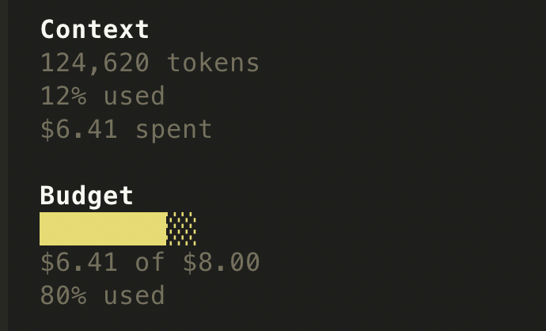
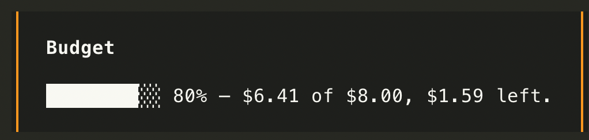

# opencode-budget-limit

Per-session spend limits for [opencode](https://opencode.ai), with a live
readout in the sidebar.

The plugin tracks what a session has cost, stops a run once it crosses the
limit, and warns before it gets there. Sub-agent sessions bill to the session
you actually see, so a spawned agent cannot quietly spend past the ceiling.



Warnings arrive as toasts before the limit becomes a wall:



## What it does

- **Hard stop.** When a session reaches its limit, the next turn is cancelled
  before any tokens are spent, and an in-flight turn that blows past the limit
  mid-run is aborted.
- **Warnings.** One-off toasts at 50%, 80% and 95% of the limit, so spend is
  visible before it becomes a wall.
- **Sidebar block.** A progress bar, amount spent, and percentage used, rendered
  directly under the built-in Context block.
- **Resume.** Raising the limit after a run was cut short drops `continue` into
  the prompt box, so picking the work back up is one keypress — and the wording
  stays yours.
- **Slash command.** `/budget` to inspect, `/budget <amount>` to set,
  `/budget +<amount>` to top up, `/budget off` to remove the limit,
  `/budget reset` to fall back to the default.

## Requirements

- opencode **1.18** or newer.
- macOS or Linux. Windows is not supported.

## Install

```sh
opencode plugin opencode-budget-limit
```

This package exposes two entry points — a server plugin (the enforcement) and a
TUI plugin (the sidebar block) — and opencode keeps those in two different
config files. `opencode plugin` reads the package's `exports`, notices both
targets, and writes each one into the right file for you: the server entry into
`opencode.json` and the TUI entry into `tui.json`.

Then add the slash command at `~/.config/opencode/commands/budget.md`:

```markdown
---
description: Show or change the spend limit for this session
---

budget $ARGUMENTS
```

Restart opencode.

### Manual install

If you would rather wire it up yourself, both files need editing. Neither one is
a fallback for the other — the TUI never reads `opencode.json`, and the server
never reads `tui.json`.

`~/.config/opencode/opencode.json`:

```json
{
  "$schema": "https://opencode.ai/config.json",
  "plugin": ["opencode-budget-limit"]
}
```

`~/.config/opencode/tui.json`:

```json
{
  "$schema": "https://opencode.ai/tui.json",
  "plugin": ["opencode-budget-limit"]
}
```

Listing the package in only one file gives you half the plugin: enforcement
without the sidebar, or nothing at all.

## Configuration

### Limits

| Command | Effect |
| --- | --- |
| `/budget` | Show spend, limit, and how much is left |
| `/budget 5` | Set this session's limit to $5.00 |
| `/budget +2` | Raise this session's limit by $2.00 |
| `/budget off` | Remove the limit for this session |
| `/budget reset` | Drop the override; fall back to the default |

Limits apply to the root session. A sub-agent spawned from a session shares that
session's budget rather than getting a fresh one.

### Environment variables

| Variable | Default | Meaning |
| --- | --- | --- |
| `OPENCODE_BUDGET_DEFAULT` | `1` | Default limit, in dollars, for sessions with no override |
| `OPENCODE_BUDGET_WARN` | `0.5,0.8,0.95` | Comma-separated fractions of the limit that trigger a warning toast |
| `OPENCODE_BUDGET_FILE` | *(see below)* | Absolute path to the limits file |
| `OPENCODE_BUDGET_DEBUG` | unset | Set to `1` to write a debug log next to the limits file |

### Limits file

Limits live in:

```
$XDG_DATA_HOME/opencode/budget-limit.json
```

falling back to `~/.local/share/opencode/budget-limit.json` when `XDG_DATA_HOME`
is unset. `OPENCODE_BUDGET_FILE` overrides the whole path.

The server and the sidebar resolve this location through the same helper
(`src/budget-file.js`), which is the only reason they are guaranteed to agree on
one file. If you are patching this package, do not inline that logic.

The format:

```json
{
  "version": 2,
  "default": 1,
  "sessions": {
    "ses_abc123": { "limit": 5, "updatedAt": 1755600000000 },
    "ses_def456": { "limit": "unlimited", "updatedAt": 1755600000000 }
  }
}
```

`"default"` is the limit for any session without an entry. A session's `limit`
is either a number of dollars or the string `"unlimited"`. Entries untouched for
30 days are pruned on startup.

Earlier versions kept this file at
`~/.config/opencode/plugins/budget-limit.json`. That path is still read when the
new one is missing, and the next write migrates it, so upgrading does not lose
existing limits.

## Development

Clone the repo and point both config files at the checkout:

```json
// ~/.config/opencode/opencode.json
{ "plugin": ["/path/to/opencode-budget-limit"] }
```

```json
// ~/.config/opencode/tui.json
{ "plugin": ["/path/to/opencode-budget-limit"] }
```

Relative paths in a config file are resolved against that file's directory.

Then:

```sh
npm install
npm run build     # src/tui.tsx -> dist/tui.js
```

`npm run build` is required before the TUI half will load, and it runs
automatically on `prepublishOnly`.

### Why there is a build step

opencode compiles Solid JSX on the fly with a Bun plugin, but its filter
deliberately excludes `node_modules`:

```
/^(?!.*[/\\]node_modules[/\\]).*\.[cm]?[jt]sx?(?:[?#].*)?$/
```

So raw `.tsx` works while you develop from a checkout outside `node_modules`,
and silently stops working the moment the package is installed. A published
package must ship precompiled JS. `build.mjs` runs `babel-preset-solid` with
`{ moduleName: "@opentui/solid", generate: "universal" }` — the same options the
host uses — so the output targets the host's runtime.

Imports of `solid-js` and `@opentui/solid` stay as bare specifiers in the built
output on purpose: opencode rewrites them to its own runtime, and that rewriting
*does* apply inside `node_modules`. They are devDependencies, never runtime
dependencies, and this package has no runtime dependencies at all.

### Layout

```
src/budget-file.js   shared path resolution — imported by both entries
src/server.js        enforcement; default-exports { id, server }
src/tui.tsx          sidebar block; default-exports { id, tui }
build.mjs            src/tui.tsx -> dist/tui.js
```

A plugin module may default-export `{ id, server }` or `{ id, tui }`, but never
both from the same module — opencode rejects that outright. Hence two entries
and two `exports` keys.

## License

MIT
